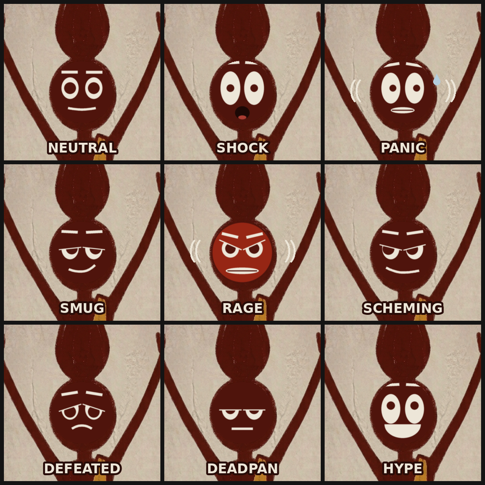

# Old Brain

**Same brain. 40,000 years apart.**

Production engine for the Old Brain Shorts channel: the same scenario in the Stone Age and in modern life, side by side. Faceless, cave-painted, voiced by its creator.

## The law
Everything obeys `spec/`. When a tool fights the spec, we change the tool.
- `spec/show-bible-v0.md`: faces, body, environments, camera, story formula, controversy rules
- `spec/archetype-spec-v1.md`: cast, palette, chalk outline, silhouettes, era swap, voices
- `spec/archetypes.yaml`: the same rules, machine-readable. Code reads this.

## What works today (`oldbrain/`)
| Module | What it does | Built on |
|---|---|---|
| `cutout.py` | Lifts a painted figure off the limestone by pigment colour; keeps painted white eyes, keeps wall loops transparent | numpy/scipy (rembg as fallback) |
| `plate.py` | Clean wall plate behind the figure for parallax | built-in fill; LaMa for hero shots |
| `outline.py` | Spec chalk outline (#EDE6D8, 6px @1080w floor, rough edge) and the validator that rejects figures without it | numpy/scipy |
| `face.py` | Parametric faces: eye whites, pupils, lids, chalk brows, mouths, sweat, tremble, rage flush. 9 presets from the bible | PIL |
| `camera.py` | Bible camera moves on multiplane layers: push-in, pull-back, snap zoom, shake, whip pan; contact shadows | numpy/PIL (DepthFlow for single-image depth) |
| `assemble.py` | Shots to 1080x1920 30fps MP4; whip era-cut, handprint portal, safe-zone captions | MoviePy, ffmpeg |
| `voice.py` | Per-archetype voice chains from the spec, crowd builder from her takes, -14 LUFS master | Pedalboard, ffmpeg-normalize |
| `qa.py` | Technical gate on the final MP4: encode, no fade-up, hook text by frame 1, 9:16 safe zone, cut rhythm, loop seam | rebuilt from iart-ai/tiktok-video-skills |
| `lipsync.py` | Rhubarb phonetic cues (gibberish-safe) to mouth shapes | Rhubarb |

Demo: `python examples/prophet_demo.py <poses_dir> out.mp4` renders `docs/media/prophet-test.mp4` from three painted poses.

## Layout
| Path | Contents |
|---|---|
| `spec/` | Source of truth |
| `oldbrain/` | Our engine |
| `vendor/<tool>/` | Full source copies we own and modify; each has `UPSTREAM.md` (origin, pinned commit, license) |
| `docs/` | Tool map, modification backlog, repo research (45 verified repos) |
| `episodes/ep-NNN/` | One folder per episode |
| `tests/` | Spec gate, run by CI on every push |

## Rules
1. Vendored code is ours to modify and improve. Log every change in that tool's `UPSTREAM.md`.
2. Output is 1080x1920, 30fps, -14 LUFS.
3. Voices are the creator's own recordings. No AI voiceover.
4. Model weights carry their own licenses: Depth Anything V2 **Small only**; rembg **not** the default bria model.

## License
AGPL-3.0 (required by vendored DepthFlow). Vendored projects keep their own licenses and notices. The Old Brain characters, show bible and artwork are the channel's creative work.
